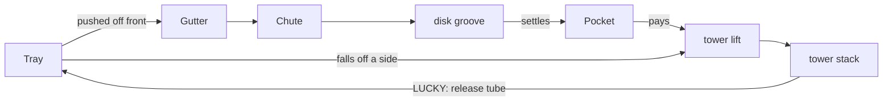

# Architecture

- **Rendering:** TypeScript, Vite, three.js with `EffectComposer` and `UnrealBloomPass`.
- **Physics:** Rapier (`@dimforge/rapier3d-compat`, rigid-body physics with its WASM embedded as base64).
- **Sound:** Web Audio, all synthesized procedurally.
- **Tests:** Vitest. A Node project covers rules and simulation; a Chromium browser project covers rendering, sound, and UI. Coverage is V8.
- **Build:** `vite-plugin-singlefile` inlines everything into one HTML file, so the production build runs from `file://`.

## Layers

```mermaid
flowchart LR
  Input[pointer / Space / C / HUD buttons] -->|firing, credit, reset, mute| Game[app.ts Game]
  Game -->|tryLaunch / onSlot / onPocket / tick / returnPearl| Rules[rules/game — pure]
  Rules -->|Effect[]: dropBalls, dropPearl| Game
  Game -->|spawnShot / queueDrop| Physics[sim/physics — Rapier]
  Physics -->|SimEvent[]: slot, frontExit, sideExit, impact| Game
  Game -->|launch / sendToLift| Disk[sim/disk — pure]
  Disk -->|pockets, returned| Game
  Game -->|cues, update| Sound[audio/sound — Web Audio]
  Game -->|flash| Stage[render/stage — three.js]
  Rules -->|state| Stage
  Physics -->|body poses| Stage
  Disk -->|pearl phases, disk angle| Stage
  Rules -->|state, notices| HUD[ui/hud — DOM]
  Debug[ui/debugMenu] -->|tunables, cheats, lights| Game
```

| Module | Owns | Must not |
|--------|------|----------|
| `src/config.ts` | Every rule and geometry tunable: geometry (cm), payouts, ladder values, durations. Mutable, so the debug menu can change values live | — |
| `src/rng.ts` | Seeded PRNG (mulberry32) | — |
| `src/rules/game.ts` | Credits, shots, tickets, ladders, parties, jackpot, payouts, tower pearl reserve; returns `Effect[]` | import three, Rapier, or audio; read wall-clock time |
| `src/sim/physics.ts` | Rapier world: peg board, slots, tray, rails, pusher, scraper; ball bodies; exits; impact detection; stall recovery | know payouts |
| `src/sim/pearlPath.ts` | Geometry of the pearl's trip outside the tray (gutter, chute, groove, lift, tower stack, release tube), shared by the disk sim and the stage | — |
| `src/sim/disk.ts` | Pearl phases after the tray: chute → disk groove → pocket → lift → tower stack; release → tray | know payouts |
| `src/app.ts` | `Game`: fixed-step loop, input, event routing, sound/flash cues, reset, mute; `debugControls()` | contain rules |
| `src/render/stage.ts` | Renderer, camera rig, bloom, environment map, lights, instanced balls and pearls, LED animation, LCD repaint | mutate game state |
| `src/render/cabinet.ts` | Static cabinet geometry and materials | — |
| `src/render/textures.ts`, `lcd.ts` | Procedural canvas art (panel, logo, slot windows, signs, disk face, 7-segment display, LCD) | — |
| `src/render/settings.ts` | Live view tunables (`VIEW`): camera, render, LEDs | — |
| `src/audio/sound.ts` | `SoundEngine`: synthesis, mix, music sequencer | — |
| `src/ui/hud.ts`, `debugMenu.ts` | DOM overlay and the data-driven debug panel | — |
| `src/main.ts` | Reads the URL and boots `Game` into `#app` | — |

## Time and determinism

- Simulation runs on a fixed 1/120 s step with an accumulator, capped at 8 steps per frame to avoid a spiral of death. The debug time scale multiplies real time before the accumulator.
- Rules receive simulated time (`simTime`), never `performance.now()`. Party timers therefore pause when the tab is hidden, and tests stay exact.
- Every random draw (shot entry and spread, drop positions, pearl entry speed) uses the seeded RNG (`?seed=N`).
- Measured cost: about 0.4 ms per physics step with ~150 bodies, roughly 5% of a core at 120 Hz.

## Pearl circulation

Pearls are a fixed set (`TRAY.initialPearls` on the tray plus `RULES.pearlReserveStart` in the tower), as on the reference cabinet, where pearls ride back up the clear tower.



**No jumps.** Every hand-off shares an endpoint (`pearlPath.ts`); `pearlPath.test.ts` checks each one and samples every segment for sudden moves:

| Hand-off | Shared point |
|---|---|
| tray → gutter | the position physics reports with `frontExit`/`sideExit` |
| chute → disk | `DISK_ENTRY`, where rolling starts |
| pocket → lift | the pearl's position in its hole; capture eases into the hole instead of snapping |
| lift → stack | the slot it will occupy. The stack hangs from the tower cap, so a rising pearl stops under the lowest pearl and never passes through the stack |
| stack → release | the slot it leaves |
| release → tray | `TOWER.releaseExit`, where physics spawns the pearl, moving along the tube |

`disk.test.ts` checks conservation: every launched pearl pockets exactly once, every pearl returns exactly once, and every release completes.

**Starting tray.** Pearls get one shuffled depth band and one shuffled width column each, so no two share a row and they reach the edge at different times. They're held fixed while randomly packed white balls settle behind a temporary loading fence.

Two failure modes led to this layout:
- **Grid packing:** squeezed the pearls into the ball rows, lining them up.
- **No fence:** a quarter of the pile avalanched off the front before play started.

## Physics model (units: cm, gravity −981 cm/s²)

- **Peg board:** two acrylic panes 4.8 cm apart confine balls to a near-2D fall.
  - Static cylinder pegs sit in centered, staggered rows, plus wall bumpers on every row, so no free lane runs down the sides.
  - Seven slot bins sit at the bottom. A ball whose center drops below the bin line is consumed and reported as `slot(i)`.
  - **No CCD.** Peak speed (~3 cm/step at 120 Hz) can't skip the 5.2 cm a ball needs to clear a peg. Hard CCD froze touching bodies (repeated zero time-of-impact); soft CCD's predictive contacts held balls in mid-air.
  - **Contact prediction** is cut to 0.2 cm (`normalizedPredictionDistance = 0.002`). Rapier's default scales to 2 cm at `lengthUnit = 100`, which is enough for two pegs' prediction bands to cradle a ball between them.
  - **Collision groups:** board balls collide with static geometry only. Otherwise two balls side by side arch between pegs and jam the board.
  - **Stall recovery,** like cabinet vibration: a ball at rest for 0.6 s is kicked. After three kicks it drops straight into the bin below where it stalled. Tests: every shot reaches a slot across seeded bursts, and a held ball is rescued into the slot below it.
- **Tray:** static floor. Low side rails stop 7 cm short of the front edge, so balls at the open corners fall off the sides; the front edge is open.
- **Pusher:** a kinematic box moving sinusoidally along z. A fixed scraper wall just above the pusher sweeps riders off on the retract stroke. The initial pile settles with the pusher parked, so nothing spills before play.
- **Exits:** a body below the tray and past the front edge is a `frontExit`; past either side, a `sideExit`.
  - White balls on `frontExit` recycle with no payout.
  - Pearls on `frontExit` go to the disk.
  - Pearls on `sideExit` ride the lift without paying.
- **Impacts:** each step compares every body's velocity change with gravity's. A change of more than 30 cm/s emits `impact(kind, intensity, x)` for sound; kind is peg, tray, or pearl.
- **Disk:** not a Rapier simulation. A pearl rides a circular groove in world space while the holed disk rotates beneath it.
  - The pearl's speed relative to the disk decays exponentially to a small creep floor below the capture speed, so every pearl settles.
  - A pass over a hole at high speed is an "in and out".

## Rendering

The cabinet is modeled on reference frames from the videos in `media/`: layout, palette, and finish only, with no logos or character art.

- **Board area:** a black circuit-art back panel with silver "wing" traces, satin screw pegs over the LCD, gold-framed slot windows, and yellow neon chevrons.
- **Tray area:** a mirror tray, acrylic walls, and PEARL / BIG PEARL side signs.
- **Pearl column:** a clear hexagonal tower with an LED strip and the pearl reserve, and the pocket disk in an LED bowl at its foot.
- **Top and front:** a red seven-segment jackpot counter, a topper sign, and a slanted control deck with speaker grilles.
- **Materials:** pegs use a rougher "satin" finish because mirror chrome on dozens of small heads bloomed into a glare patch over the LCD. The LCD's peak white is held under the bloom threshold.
- **Lighting:**
  - Reflections come from a PMREM environment generated from a small arcade-room scene: ceiling strips and neon side panels.
  - Hemisphere, key (shadows), and four colored point lights are registered for the debug light editor.
- **Instancing:** white balls, pearls (tray, disk, lift, and reserve), pegs, and LEDs are each one `InstancedMesh`.
- **Animation:** tower LEDs chase cyan (rainbow during parties); the bowl ring cycles hues; chevrons pulse during parties.
- **LCD:** a 1280×720 `CanvasTexture` repainted at 20 Hz.
  - A cached galaxy backdrop sits behind a value wheel showing the live pocket pays (SUPER plus the jackpot during Ball Party).
  - The wheel's hub shows LUCKY BALL with the tower count; curved ladders follow its rim; party banners carry countdowns.
  - Flash overlays mark jackpot, party, and lucky events.
- **Camera:** an orbit rig (distance, pitch, yaw, target) from `VIEW`.
  - On narrow screens the distance is scaled up so the cabinet width fits.
  - Zoom changes the distance: wheel, ctrl+wheel (trackpad pinch), two-finger touch pinch, or `+`/`-`, clamped to `ZOOM_RANGE`.
  - Free orbit is a debug option.

## Sound

`SoundEngine` (src/audio/sound.ts) is pure Web Audio: oscillators, one generated noise buffer, filters, envelopes, and a convolver with a generated impulse response.

- **Mix:** SFX, music (ducked under jingles), and ambience buses feed a master gain, a glue compressor, and a limiter.
- **Reference measurements:** taken from `media/NEW PUSHER… [3-koMfby63A].mkv` and the expo clip. Commentary overlaps, so they are approximate.
  - Peg clicks peak at 1.2–2.0 kHz (0:27, 6:38, 9:20) and are modeled as a 1.6–2.8 kHz band-passed noise click plus a faint ring.
  - The idle and attract music pulses at about 92 BPM in both cabinet clips → a G-major I–vi–IV–V bed.
  - Party Time (1:19, 1:32) pulses at about 199/min with a brighter spectrum → a G-minor bed at 100 BPM: eighth hats, kick, claps, bass, and a square lead.
  - Ticket Party is the lighter major variant.
- **Cues:** launch whoosh, tray clatter, pearl thump, slot jingles (BALL arpeggio, TICKET bell, LUCKY sparkle), lucky win/miss, pocket payouts scaled by tier, jackpot (brass stabs, siren, bell run), party start/end, credit "ka-ching".
- **Ambience:** mains hum, a pusher motor following pusher speed, and a disk rattle while pearls roll.
- **Budget:** impacts are throttled per kind and capped at 12 concurrent voices; quiet hits are dropped when busy.
- **Unlock and mute:** nothing is created before the first user gesture (`unlock()`). Muting stops voice creation and silences the master gain.

## Testing

- **unit (Node):** rules, the pocket disk (pearl conservation), and physics (board drain, exits, impacts, drops, stall rescue).
- **browser (headless Chromium):**
  - `Game` flows: input, launching, slots, the pearl path, parties, the jackpot, buttons, mute persistence, the debug wiring, and the main entry.
  - Stage view settings and portrait camera fit.
  - The LCD's content per state, and seven-segment pixels.
  - The HUD.
  - The debug panel DOM: params, presets, the light editor, keys.
  - Sound, rendered offline: every cue is audible and releases its voices; plus loudness ordering, throttling, mute, and music beds.
- `npm run coverage` enforces 90% statements, branches, functions, and lines.

## Extension points

- **Payout multipliers:** the source shows values beyond the table. Add them to `rules` via config; the disk does not change.
- **Four-player cabinet:** instantiate N stations, each with its own `GameRules` and physics sub-world, sharing one jackpot.
