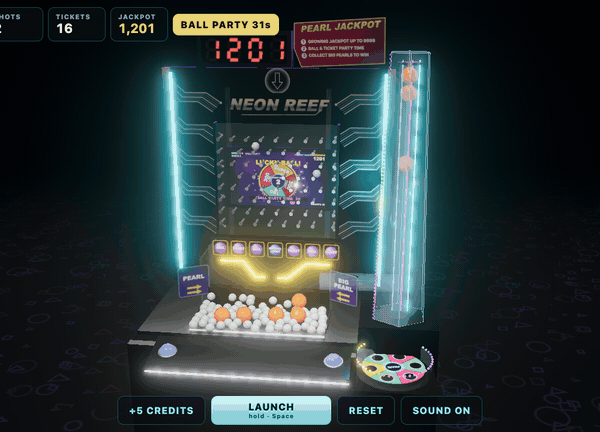

# Neon Reef — Pearl Pusher

A 3D browser ball-pusher that recreates the gameplay, look, and sound of the *Victoria Coin Island* arcade cabinet, a "Pearl Fishery"-style machine.
three.js renders the cabinet with bloom, Rapier simulates every ball, and Web Audio synthesizes all sound.
Branding, art, and audio are original; nothing is copied from the reference footage.



**Play:** https://jamiely.github.io/vicky/ (deployed by `.github/workflows/deploy.yml` on every push to `main`).

## Run

```sh
npm install
npm run dev          # http://localhost:5173  (?seed=123 for a reproducible machine, ?debug=1 for the debug menu)
npm run build        # dist/index.html: one self-contained file
open dist/index.html # works from file://
```

Opening the repository's root `index.html` directly does not work. It is the Vite source entry; use `npm run dev` or the built `dist/index.html`.

## Play

- **Hold** LAUNCH, Space, or the cabinet itself to fire balls into the peg board (2/s). Shots cannot be aimed.
- **Credits:** press `C` or click **+5 CREDITS** to add five credits. Holding `C` adds only one batch, not one per key repeat.
- Balls land in `BALL · TICKET · BALL · BIG BALL LUCKY · TICKET · BALL · TICKET`.
  - **BALL** drops white balls onto the pusher tray and climbs the ball ladder.
  - **TICKET** pays the ticket-ladder value and climbs the ticket ladder.
  - **LUCKY** releases a big orange pearl from the clear tower on the right (the LCD hub shows how many are waiting).
  - Each hit knocks the other ladder back.
- Topping a ladder starts a 31 s **Party Time**. In **Ball Party**, BALL drops double balls, pearls pay 180/300, and yellow pays the progressive **jackpot**.
- Pearls pushed off the front roll along the gutter, down the chute onto the spinning disk, and pay by pocket color. Pearls that fall off the sides pay nothing.
- **Where new pearls come from:** pearls are a fixed set that circulates. After paying (or falling off a side), each pearl rides the lift up the tower and hangs in the stack under its cap. LUCKY releases the bottom pearl down the tower and out of the tube onto the tray.
- **Zoom:** mouse wheel, trackpad pinch, two-finger pinch on touch screens, or the `+` / `-` keys. For free camera orbit, use the debug menu.
- **SOUND ON/OFF** toggles audio (remembered). Audio starts on your first click or key press.

## Debug menu

Open with `?debug=1`, then press backquote (`` ` ``) or the DEBUG button to toggle it. It is modeled on the debug panel in `../fast-drop`.

- **Camera:** distance, pitch, yaw, target, FOV, and free mouse orbit.
- **Render:** exposure, bloom, shadows, reflections, LED speed and brightness.
- **Simulation:** time scale, pause, auto-fire rate, pusher period, disk spin and decay.
- **Rules:** ladder length and knockback, balls per hit, party length, payouts.
- **Machine (on reset):** starting balls, pearls, credits, and jackpot.
- **Cheats:** step, force a BALL/TICKET/LUCKY slot, drop balls or a pearl, start either party, send a pearl to the yellow pocket, reset.
- **Lighting editor:** pick a light; toggle it, change its color, intensity, and position, or add point and spot lights.
- **Presets:** save and load settings (localStorage); copy the current values as JSON.

## Test

```sh
npx playwright install --only-shell chromium   # once
npm test                                        # unit (Node) + browser (headless Chromium) projects
npm run coverage                                # same, with V8 coverage; fails below 90% on any metric
npm run typecheck
```

Rendering, sound, and UI tests run in real headless Chromium:

- WebGL uses SwiftShader, so the real three.js scene renders.
- Sound tests render through an `OfflineAudioContext` and check the signal each cue produces.
- Rules and simulation tests run in Node.

## Desktop (Electron)

The desktop app is an offline game, modeled on the `../stack` repo's Electron setup.

- It serves the built game from `dist/` over a private `vicky://app` protocol.
- The renderer is sandboxed, with no Node integration and no remote navigation.
- It opens fullscreen: `Escape` quits and `F11` toggles fullscreen.

```sh
npm run electron:start      # build and launch
npm run electron:dev        # Vite hot reload inside Electron (port 5174)
npm run electron:smoke      # real-window check; saves dist_electron/electron-smoke.png
npm run build:electron:win  # Windows x64 portable + NSIS installer
```

`electron:smoke` checks:
- WebGL renders.
- Every asset comes from `vicky://app`.
- A real Space key press launches balls into a slot, and audio unlocks.
- LUCKY releases a pearl onto the tray.
- A pearl pushed off the tray reaches the disk.

`.github/workflows/release-electron.yml` builds, smoke-tests, and packages the Windows app on every push and pull request. Every push to `main` refreshes the rolling `latest` prerelease; a `v*` tag publishes a versioned release.
For LaunchBox, point it at the `portable.exe`.

### Vermilion cabinet controls

The Windows x64 Electron portable build is installed in LaunchBox's **Arcade** platform as **Neon Reef** at `C:\arcade\Neon Reef\Neon-Reef-0.2.0-win-x64-portable.exe`.

Both connected controllers use the same two physical button numbers as the existing cabinet profiles:

| Button | JoyToKey key | Action |
| --- | --- | --- |
| 7 | Space | Hold to fire; release to stop |
| 5 | C | Add five credits; hold for 1.5 seconds to exit |

LaunchBox's before-launch additional application runs `C:\arcade\Neon Reef\JoyToKey_NeonReef.ahk`, which loads `Documents\JoyToKey\NeonReef.cfg`. The hold-to-exit shortcut is scoped to the game's window. The hook stops JoyToKey and releases its mapped keys when the game exits, so its bindings do not remain active in LaunchBox. Other games' profiles are unchanged.

The installed game and mapped Windows keys were exercised remotely; physical button presses still need a cabinet-side check.


## Docs

- [REQUIREMENTS.md](REQUIREMENTS.md): rules, each tagged with evidence from the reference videos (frame or transcript timestamps) or marked as inference/tuning.
- [ARCHITECTURE.md](ARCHITECTURE.md): module boundaries, data flow, physics, rendering, sound, testing.

The reference footage in `media/` is gitignored.
